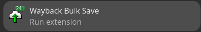

# Wayback Bulk Save

Save a list of web pages to the Wayback Machine with your archive.org account.
Paste addresses or import a file, choose **Save Pages** and let the queue run.
The add-on saves one page at a time and links to each snapshot when it's ready.

This is an unofficial Firefox add-on, not made by or affiliated with the
Internet Archive.

## Install

Requires Firefox 115 or later and an archive.org account.

### Install the Signed XPI

Use this option when you have a signed `.xpi` file.

1. Save the signed `.xpi` file to your computer.
2. In Firefox, open `about:addons` and select **Extensions**.
3. Open the gear menu and choose **Install Add-on From File...**.
4. Select the `.xpi` file and confirm the installation.

The installed add-on stays available when Firefox restarts.

### Load for Development

1. Download or clone this repository.
2. In Firefox, open `about:debugging#/runtime/this-firefox`.
3. Choose **Load Temporary Add-on** and select `manifest.json` from this
   folder.

This loads the source directly, without a signed XPI. Firefox removes the
temporary add-on when it restarts. Repeat these steps to load it again.

## Save Pages

1. Sign in at [archive.org](https://archive.org/).
2. Click the Wayback Bulk Save toolbar button. The window shows whether
   you're signed in.
3. Paste one address per line, or choose **Open List...** to import a text,
   CSV or TSV file. You can also drop a file onto the address box.
4. Review the addresses and options, then choose **Save Pages**.

Addresses without `https://` are accepted. Imported addresses appear in the
box for review before anything is saved. Entries that aren't web addresses
stay in the box when you start the queue.

## Follow the Queue

You can close the add-on's window while the queue runs. Keep Firefox open.
The toolbar badge shows how many pages remain. Open the window again to
check progress and follow links to completed snapshots.

- **Stop** pauses the queue. Choose **Save Pages** to continue.
- **Retry Errors** puts failed pages back in the queue.
- **Clear Done** removes saved, skipped and failed entries from the list.

Save Page Now may skip a page it has archived recently. The queue shows its
explanation, including when another capture is allowed.

## Choose Capture Options

The add-on remembers your choices. These options are passed to Save Page Now:

| Option | What It Does |
| --- | --- |
| **Save outlinks** | Also requests captures of links found on each page. |
| **Save error pages** | Saves pages that return HTTP errors. Enabled by default. |
| **Save screenshot** | Requests a screenshot with the capture. |
| **Disable ad blocker** | Turns off Save Page Now's ad blocker for the capture. |
| **Save also in my web archive** | Adds each snapshot to your My Web Archive collection. |
| **Email me the results** | Requests a results email for each address. |
| **Email me a WACZ file with the results** | Requests a downloadable archive by email for each address. |
| **Skip if saved within** | Skips pages archived within a period such as `1d` or `12h`. |

**Wait between saves** starts at 20 seconds, the shortest it allows, so the
add-on doesn't overwhelm Save Page Now. If the service asks it to slow down,
it waits a minute, then two, then four. If your account reaches Save Page
Now's daily limit, the queue stops and the page goes back in the queue.

## Privacy

No tracking. No analytics. The add-on sends data only to the Internet Archive,
using your signed-in session. It reads archive.org's sign-in cookie to show
whether you're signed in. Your queue and settings stay in Firefox.

## License

[MIT](LICENSE)
