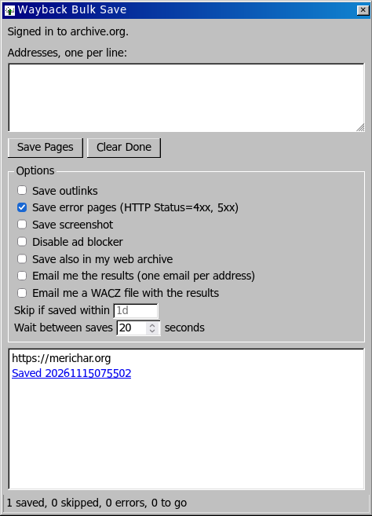

# Wayback Bulk Save

A Firefox add-on that saves a list of pages to the Wayback Machine, one at a
time, with your archive.org account.

Paste the addresses, choose Save Pages and close the window if you like. The
queue keeps going in the background, and the toolbar button's badge counts
what's left. Each page gets a link to its new snapshot when it's done.

It's unofficial: not made by or affiliated with the Internet Archive. The
Wayback Machine's own extension used to have a Bulk Save page, but it's
gone.

## Load It

1. In Firefox, open `about:debugging#/runtime/this-firefox`.
2. Choose Load Temporary Add-on and pick this folder's `manifest.json`.

A temporary add-on lasts until Firefox restarts.

## Use It

1. Sign in at archive.org. The window says whether you're signed in.
2. Click the toolbar button, paste one address per line and choose Save
   Pages. Addresses without `https://` are fine.

A line under the buttons says what was added. Anything that isn't a web
address stays in the box. While the queue runs, Save Pages reads Stop.

The options are Save Page Now's own, and the add-on remembers them:

- **Save outlinks** also saves what each page links to and loads, such as its
  stylesheets, scripts and images.
- **Save error pages** saves a page even if it answers with an error.
- **Save also in my web archive** adds each snapshot to your My Web Archive.
- **Email me the results** and the WACZ file send one email per address.
- **Skip if saved within** skips pages saved recently, such as `1d` or `12h`.
- **Wait between saves** is 20 seconds to start.

A page saved in the last hour shows as skipped, with Save Page Now's note
about when you can save it again. Retry Errors puts failed pages back in the
queue, and Clear Done removes finished ones.

## Be Kind to Save Page Now

Save Page Now is free and limits how fast one account can save. Keep the wait
at 20 seconds or more. If it asks the add-on to slow down, the add-on waits
and tries again.

## Privacy

The add-on talks only to web.archive.org, with your own signed-in session. It
reads archive.org's sign-in cookie only to show whether you're signed in, and
keeps your list in Firefox's extension storage. It collects nothing and
sends nothing anywhere else.

## License

MIT
